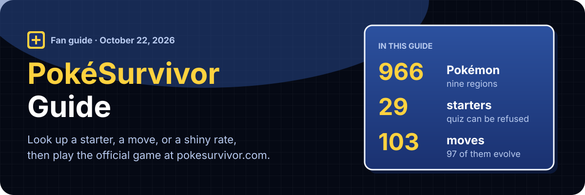
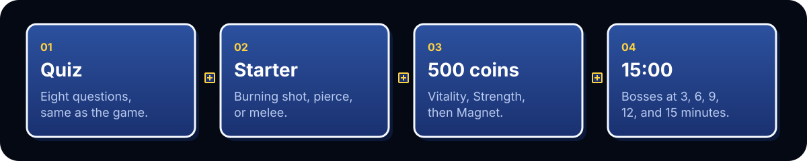

<p align="center">
  
</p>

The guide is published at **[https://pokesurvivor.net](https://pokesurvivor.net)**. Open a page, then start a run: [Play](https://pokesurvivor.net/play/) loads the official game from [pokesurvivor.com](https://pokesurvivor.com/) on this site. Guest play does not need an account.

This is a fan guide. It is not affiliated with Nintendo, Creatures Inc., GAME FREAK, The Pokémon Company, or the person who made the game.

## A run, in the order the site suggests

<p align="center">
  
</p>

| Step | Page | What it decides |
| --- | --- | --- |
| Quiz | [Starter quiz](https://pokesurvivor.net/quiz/) | The same eight questions as the game. Each result has its own link, such as [Charmander](https://pokesurvivor.net/quiz/charmander/). |
| Starter | [Best starter](https://pokesurvivor.net/best-starter/) | Burning Ember, piercing Water Gun, or melee Vine Whip. The quiz can be refused. |
| Coins | [First upgrades](https://pokesurvivor.net/first-upgrades/) | A new save starts with 500 coins. The first five buys are Vitality, Strength, Vitality, Strength, then Magnet. |
| Clock | [15-minute run](https://pokesurvivor.net/fifteen-minute-run/) | Bosses at 3, 6, 9, 12, and 15 minutes, and when a rift is worth entering. |

[Move evolutions](https://pokesurvivor.net/move-evolutions/) sits beside that path: 59 of the 64 moves evolve, and the page names the stat card each one needs. Power is the common one.

## On the site

### Play and learn

- [Play PokéSurvivor](https://pokesurvivor.net/play/) — the official game, embedded. Phone play wants landscape. A Google sign-in popup can be blocked; the official site still has the account.
- [How to play](https://pokesurvivor.net/guide/) — controls, one full run, level-up cards, and what to pick up on the map.
- [Co-op](https://pokesurvivor.net/co-op/) — up to four players. Friends are added by nickname, and a downed partner can be revived by standing next to them.
- [Weather](https://pokesurvivor.net/weather/) — weather from minute 2, and which types it changes.
- [FAQ](https://pokesurvivor.net/faq/) — where to play, shiny odds, rifts, and what this site is not.

### Choose a partner

- [Starter quiz](https://pokesurvivor.net/quiz/) — eight questions, four answers, same scoring as the game.
- [Best starter](https://pokesurvivor.net/best-starter/) — Charmander, Bulbasaur, or Squirtle teach the three opening jobs. Later regions repeat them.
- [Tier list](https://pokesurvivor.net/tier-list/) — all 29 starters by HP and speed, the six opening moves, and shiny odds.
- [Starters](https://pokesurvivor.net/starters/) — every quiz partner and the move they begin with.

### Look something up

- [Pokédex](https://pokesurvivor.net/pokedex/) — 966 Pokémon, with stats and a learnset. Each one has its own page.
- [Moves](https://pokesurvivor.net/moves/) — 64 moves, with cooldown, damage, and the evolution.
- [Type chart](https://pokesurvivor.net/types/) — the softened combat chart, 1.6 / 0.6 / 0.3, not the main-series 2 / 0.5 / 0.
- [Shinies](https://pokesurvivor.net/shinies/) — wild odds 1/4096, gacha odds 1/100, a rolls calculator, and 958 shiny sprites.
- [Legendaries](https://pokesurvivor.net/legendaries/) — 87 rift legendaries. A rift can open from 1:15.
- [Bosses](https://pokesurvivor.net/bosses/) — the five timed bosses.
- [Items](https://pokesurvivor.net/items/) — one item per run. Bosses always drop one.
- [Upgrades](https://pokesurvivor.net/upgrades/) — PokéCoins belong to each Pokémon, not the account.
- [Gacha](https://pokesurvivor.net/gacha/) — region banners, tickets, rates, and the 70-pull pity.

### This site

- [About](https://pokesurvivor.net/about/) — what the guide is, and where the numbers and sprites come from.
- [Contact](https://pokesurvivor.net/contact/) — takedowns and corrections. Email [contact@pokesurvivor.net](mailto:contact@pokesurvivor.net).
- [Privacy](https://pokesurvivor.net/privacy/) — what the pages store, and what the embedded game stores.
- [Terms](https://pokesurvivor.net/terms/) — fan-site rules for using these pages.

## What this repository is

A [Next.js](https://nextjs.org/) site, exported to static files. The pages above are the product. There is no account system in this repo.

```bash
npm install
npm run dev
npm run build
```

`npm run build` writes the site into `out/`. Production is the GitHub `main` branch, built by Cloudflare Pages. Do not deploy from a laptop.

Combat numbers, move ladders, boss times, gacha rates, and Pokédex stats are generated into `data/pokemon.json`, `data/moves.json`, and `data/bosses.json` by `scripts/extract-data.mjs`. That script reads a local checkout of [JPTER78/pokesurvivor](https://github.com/JPTER78/pokesurvivor) (`pokedex.js`, `moves.js`, `starters.js`, `sprites-meta.js`). It does not copy sprites or game code. Sprites on the site are requested from pokesurvivor.com when a page loads.

## Limits

- The guide is English. The embedded game keeps its own language.
- Figures go stale when the game changes, until the data files are extracted again.
- Sprite sheets are not in this repo. If the official host drops one, the page shows a gray stand-in.
- A rights holder can ask for a sprite or a name to be removed. Write to contact@pokesurvivor.net.

The game project's code is MIT. Sprites originate in [SpriteCollab](https://github.com/PMDCollab/SpriteCollab) under CC BY-NC 4.0. Pixelify Sans, used on the site, is SIL Open Font License. The wording of this guide is separate from those licenses.
